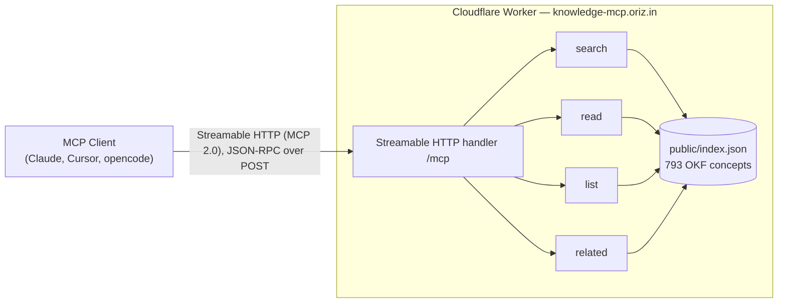

# knowledge-mcp

> chirag127's OKF knowledge bundle — 793 concept files, public and searchable over MCP. No auth, $0 to run.

[](./LICENSE)
[](https://github.com/chirag127/knowledge-mcp/stargazers)
[](https://github.com/chirag127/knowledge-mcp/commits)
[](https://workers.cloudflare.com/)

## What it is / why it exists

A **public, no-auth** [MCP](https://modelcontextprotocol.io) server that exposes chirag127's [OKF](https://knowledge.oriz.in) knowledge bundle — 793 concept files (rules, decisions, patterns) — to any AI client. Point your assistant at one URL and it can `search`, `read`, `list`, and traverse `related` concepts. Runs as a single Cloudflare Worker with a prebuilt search index bundled as a static asset, so there's no database and no cold-start cost.

## Links

- **Live MCP endpoint:** <https://knowledge-mcp.oriz.in/mcp> (Streamable HTTP, MCP 2.0)
- **GitHub Pages:** <https://chirag127.github.io/knowledge-mcp/>
- **Knowledge bundle site:** <https://knowledge.oriz.in>
- **Repo:** <https://github.com/chirag127/knowledge-mcp>

⭐ If this is useful, please star the repo — it helps others find it.

## Architecture



## Tools

| Tool | Params | Returns |
| --- | --- | --- |
| `search` | `query`, `limit?` (1–20), `type?` | Top-N concepts by term-overlap score |
| `read` | `slug` | Full concept body (markdown) by slug |
| `list` | `type?`, `tag?`, `limit?` (1–100) | Filtered concept titles + slugs |
| `related` | `slug`, `depth?` (1–3) | Graph neighbors via `related:` frontmatter |

## Features

- Public, keyless, hosted — add one URL to any MCP client
- 793 OKF concept files indexed for full-text search
- Concept graph traversal via `related:` frontmatter
- Stateless Streamable HTTP (MCP 2.0), JSON responses
- Serverless on Cloudflare — index bundled as a static asset

## Tech stack

- **Cloudflare Workers** (`nodejs_compat`), TypeScript
- [`@modelcontextprotocol/sdk`](https://github.com/modelcontextprotocol/typescript-sdk) Web-standard Streamable HTTP transport, `zod`
- `gray-matter` (build-time index generation), `wrangler` (dev/deploy)

## Repo structure

```
knowledge-mcp/
├── src/index.ts          # Worker: MCP server, 4 tools, HTTP transport, server card
├── public/index.json     # prebuilt search index (bundled asset)
├── scripts/build-index.mjs  # regenerate index.json from the knowledge bundle
├── wrangler.toml         # CF Worker config + custom domain route
└── package.json
```

## Quick start

### Use the hosted server (no install)

Add to any MCP client config:

```json
{
  "mcpServers": {
    "chirag127-knowledge": {
      "url": "https://knowledge-mcp.oriz.in/mcp"
    }
  }
}
```

Streamable HTTP transport, JSON-RPC 2.0 over POST.

### Local dev

```bash
npm install
npm run build:index      # rebuild public/index.json from local knowledge/
npm run dev              # npx wrangler dev — local Worker
npm run deploy           # npm run build:index && wrangler deploy
```

### Register it

- **MCP Registry:** <https://registry.modelcontextprotocol.io>

## Configuration

No configuration is required to use the hosted server. For local index builds:

| Variable | Purpose |
| --- | --- |
| `SOURCE_DIR` | Path to the knowledge bundle to index (default: local `knowledge/`) |

No secrets in the repo.

## Part of the oriz family

One of ~80 sites and tools in the [oriz](https://blog.oriz.in) family. It's the public, hosted counterpart to [mdv-mcp](https://github.com/chirag127/mdv-mcp) (local private vault) and pairs with the reasoning servers [Clear Thought](https://github.com/chirag127/Clear-Thought-MCP-server) and [Stochastic Thinking](https://github.com/chirag127/Stochastic-Thinking-MCP-Server).

**Cost:** $0 on the Cloudflare Workers free tier.

## Related

- Knowledge bundle: [chirag127/workspace](https://github.com/chirag127/workspace) · bundle site [knowledge.oriz.in](https://knowledge.oriz.in)
- Decision: [`knowledge-mcp-server-public-2026-07-03`](https://knowledge.oriz.in/decisions/agent-tooling/knowledge-mcp-server-public-2026-07-03.html)

## Contributing

Issues and PRs welcome. Conventional commits are the changelog.

## License

MIT — see [LICENSE](LICENSE).

## Author

Chirag Singhal · <chirag@oriz.in> · [@chirag127](https://github.com/chirag127)

## Status

Stable. Roadmap: richer ranking, incremental index updates.
